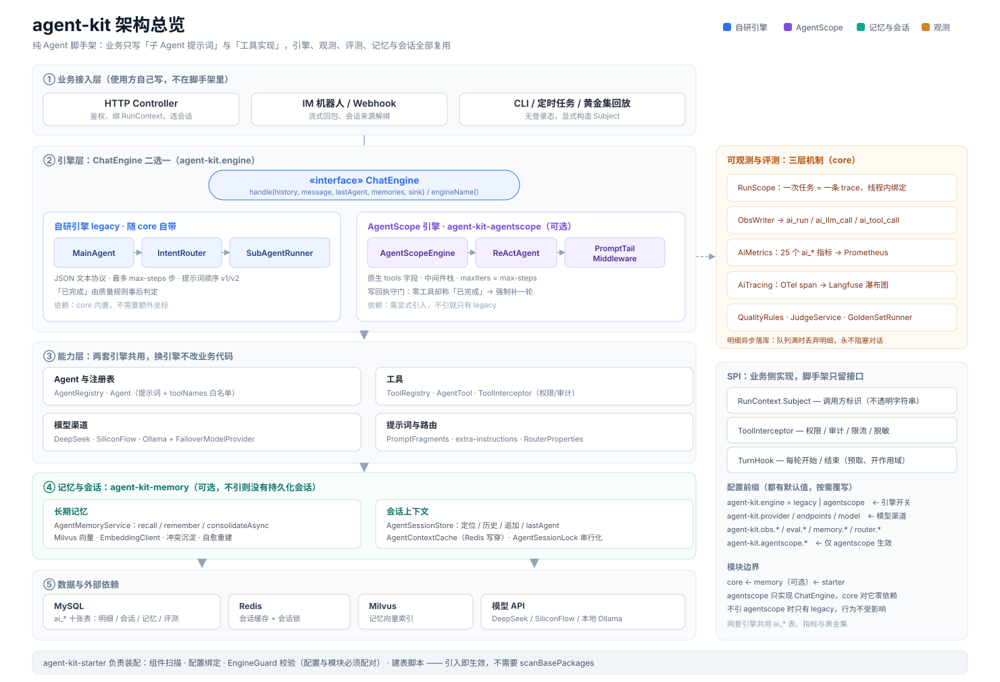

# 01 · 架构设计

> 面向要接这套脚手架、或者要改它内部实现的人。只想先跑起来看 [02-快速开始](02-快速开始.md)。

## 1. 定位与边界

一句话：**一个可复用的 Agent 运行时骨架，负责「模型怎么调、工具怎么给、一轮对话怎么编排、跑完怎么看」。**

它对业务完全无知。以下这些**故意不做**，因为每个系统的答案都不一样：

| 不做 | 谁来做 |
|---|---|
| 用户 / 租户 / 权限体系 | 业务系统。脚手架只认不透明的 `Subject.id` 与 `namespace / owner` |
| 业务表与业务事务 | 业务 Service，工具方法里直接调，复用现成的事务、锁、审计 |
| 提示词里的业务口径 | 业务方写 `Agent#systemPrompt` 与 `agent-kit.extra-instructions` |
| 工具准入规则 | 业务实现 `ToolInterceptor`（角色表？工单状态？配额？脚手架猜不到） |
| 前端渲染 / SSE 帧格式 | 业务实现 `ChatSink` 三个回调 |

判断标准只有一条：**换一个完全不同的业务，这段代码还需不需要改？** 需要改的就不进脚手架。

---

## 2. 模块与依赖



（矢量图，可放大看细节；文件在 [`images/architecture.svg`](images/architecture.svg)）

再看一眼依赖方向——它决定了升级与裁剪的成本：

```
              agent-kit-starter        引入即装配（扫描 + 配置绑定 + EngineGuard + DDL）
                     │
        ┌────────────┴────────────┐
        │ optional                │ optional
  agent-kit-memory        agent-kit-agentscope
  记忆 + 会话上下文          只实现 ChatEngine
        │                         │
        └────────────┬────────────┘
                     │
              agent-kit-core        契约与运行时（模型/工具/Agent/观测/评测）

  examples/agent-kit-example  ← 参考实现，不在默认构建里（mvn -Pexamples 才编）
```

依赖方向严格单向：core 不知道 memory 存在，memory 不知道 starter 存在。
两处反向耦合都标了 `optional`，用不用由使用方决定：starter 里的 `memory`、
以及**只实现 `ChatEngine`** 的 `agentscope` 模块——core 对 AgentScope 零依赖，
不引它默认走自研引擎，引了还要显式配 `agent-kit.engine=agentscope` 才生效
（判定与报错见 [08-引擎选型](08-引擎选型.md)）。

**core 不依赖数据库也能编译**：观测明细通过 MyBatis-Plus 写 `ai_*` 表，但只依赖
`RunMapper` 这类接口；没有数据库时观测开关一关，对话链路照常跑。

---

## 3. 一次对话的完整链路

以「帮我记一下周五交房租」为例：

```
业务入口（Controller / IM Handler）
  │
  ├─ ① RunContext.set(Subject)          ← 谁来发起这次运行（不透明字符串）
  │
  ├─ ② 会话定位（AgentSessionStore）      ← 新建 or getWritable（顺带做归属校验）
  │
  ├─ ③ 记忆检索（AgentMemoryService）     ← 锁外、可失败，失败返回空列表
  │
  ├─ ④ 会话锁（AgentSessionLock）         ← 同一会话串行化
  │     │
  │     ├─ recentHistory()  读历史
  │     ├─ append(USER)     先落库，崩了也有痕迹
  │     ├─ RunScope.bindSession()
  │     ├─ ChatEngine.handle()
  │     │    │
  │     │    ├─ MainAgent
  │     │    │    ├─ IntentRouter.route()   模型判意图 → 路由到 1..N 个子 Agent
  │     │    │    │   （判"无关"时走关键词兜底 / 上一轮 Agent 延续 / 直接回复）
  │     │    │    └─ 逐个 SubAgentRunner.run()
  │     │    │         ├─ 拼提示词（系统提示 + 工具清单 + JSON 协议 + 记忆 + 日期）
  │     │    │         ├─ ModelRouter.forAgent(agent)  ← 标签 > Agent > 默认
  │     │    │         │    └─ ModelProviderRegistry.route() → 主备组合
  │     │    │         ├─ 模型回 {"tools":[...]} → ToolRegistry 找工具 → ToolInterceptor.before
  │     │    │         │                                      → execute → after
  │     │    │         ├─ 模型回 {"reply":"..."} → sink.delta 流式输出
  │     │    │         └─ 每步落 ai_llm_call / ai_tool_call（异步队列）
  │     │    │
  │     │    └─ merge()  多子 Agent 结果拼接
  │     │
  │     ├─ append(ASSISTANT, toolEvents)
  │     └─ RunScope.unbindSession()
  │
  └─ ⑤ 记忆提炼（异步，锁外）              ← 失败只影响"下次记不记得"
```

**顺序不能改**，每一处换位都会出一个安静的错误（模型看不到上一轮、锁持有时长翻倍、
记忆串分区、反馈倒查不到 runId）。完整理由见
`examples/agent-kit-example/.../support/ConversationFacade.java` 的文件头注释。

### 流式事件的四帧

`ChatSink` 有四个方法，对应前端四处 UI：

| 回调 | 时机 | 前端表现 |
|---|---|---|
| `status(stage, label)` | 路由中 / 执行中 / 第 n 个子 Agent | 顶部状态行 |
| `tool(name, success, summary)` | 一次工具调用结束 | 工具调用条 |
| `delta(text)` | 正文增量 | 气泡逐字出现 |
| `error(code, message, retryable, hint)` | 已经输出过正文、但中途失败 | 保留已有内容，底部补一行错误提示 |

回调都在请求线程里同步触发，实现方不用考虑并发。

**`error` 是唯一的「收尾帧」**，它存在的理由与 HTTP 的时序有关：流式一旦开始，200 和
响应头就已经发出去了。此刻再抛异常只会断开连接——前端拿到的是「网络错误」，不会走错误处理
逻辑；已经吐出去的那半句话停在界面半空，刷新后又整段消失（库里只写了用户消息）。

所以约定只有一条：**判断依据是「正文有没有发出去过」，不是「异常发生在哪一层」**。

| 情形 | 行为 |
|---|---|
| 一个字都没输出就失败 | 原样上抛 → Controller 转成 JSON 错误响应体（前端走错误分支） |
| 已经输出过正文后失败 | 推一帧 `error` + 正常返回已产出的部分（库里落真实产出，前端可重试） |

三个调用点都按这条规矩收尾：子 Agent 的总结调用、两个引擎的多 Agent 串行循环
（第 N 个失败时保留前 N−1 段）、业务侧会话门面的兜底（防止自定义 `ChatEngine` 不守约定）。
具体实现收口在 `StreamFailure`，状态仍记 `FAIL`——不新增 `PARTIAL` 枚举值，
否则现有「成功率 = SUCCESS / 总数」的看板会静默漏数。

`delta` 的粒度受 `agent-kit.stream` 控制：关掉后没有中间帧，只在结束时推一次完整正文
（协议不变，前端不用改代码）。什么时候该关：内网反向代理会把 SSE 缓冲到收完才吐
（比不流式更糟）、或网关对 `stream=true` 直接 400。按渠道覆盖用 `endpoints.{id}.stream`。

---

## 4. 七个关键设计决策

### 4.1 工具调用用「JSON 文本协议」，不用各家 `tool_calls` 报文

模型被要求在正文里输出 `{"tools":[{"name":..,"args":{..}}]}` 或 `{"reply":"..."}`。
代价是要自己解析、要容忍模型不守协议；收益是换模型不改协议——DeepSeek、Ollama
本地模型、任何 OpenAI 兼容网关都走同一套提示词，`ModelProvider` 只负责 HTTP 与流式解析。

代价的兜底在 `SubAgentRunner`：解析失败会重问一次，仍失败则置 `parse_fail=1` 并走兜底
话术，由质量规则 R2 抓出来。

### 4.2 工具隔离靠白名单，不靠提示词自觉

`Agent#toolNames()` 是硬白名单：`ToolRegistry.specs(names)` 只把白名单里的工具渲染进提示词，
执行时 `find(name)` 也只会命中白名单内的工具。模型幻觉出一个不存在的工具名，拿到的结果是
「没有这个工具」而不是「调了别的东西」。

**工具清单必须按名字排序输出**（`ToolRegistry#specs` 里做了）。`Set.of(...)` 有每进程随机
SALT，同一份 jar 连启三次会给出三种迭代顺序；顺序一变，模型侧的前缀缓存整段作废。

### 4.3 观测异步落库，永不阻塞对话

`ObsWriter` 是一条 `ArrayBlockingQueue` + 单线程消费 + 批量写入。队列满时**丢观测、不阻塞**
（`ai_obs_queue_dropped_total` 计数），写失败只加 `ai_obs_write_failed_total`。

理由：观测是「看」的能力，不是「跑」的前提。让埋点把对话拖慢或拖挂，是拿主业务换附属品。

### 4.4 身份是三个不透明字符串

- `RunContext.Subject.id`：谁发起的（进 `ai_run.subject_id`，脚手架不解析）
- `namespace`：分区键（租户 / 组织 / 项目）
- `owner`：归属方（用户 id / 工单号 / 设备号），`null` 表示分区内共享

一旦这里出现 `userId` / `tenantId` 这类具体字段，就等于把别人的账号体系搬进脚手架：
字段要么冗余、要么不够用，还得跟着业务表改。

### 4.5 配置类注册方式二选一

`@Component` + `@ConfigurationProperties` 与 `@EnableConfigurationProperties` **只能用一种**。
两种一起用会在容器里产生两个同类型 Bean（名字不同），按类型注入的地方直接报
`required a single bean, but 2 were found`。

当前分工：
- 有 `@Component`：`ObsProperties`、`EvalProperties`（组件扫描注册）
- 没有 `@Component`：`AiProperties`、`RouterProperties`（`AiConfig` 注册）、
  `MemoryProperties`（`MemoryConfiguration` 注册）

### 4.6 引擎是可替换的接口

`ChatEngine` 只有 `handle(...)`、`engineName()` 和三个引擎标识常量。默认实现 `MainAgent`
是自研薄运行时；AgentScope 是同一接口的第二个实现，装在**独立模块**里，靠
`agent-kit.engine` 二选一。上层（Controller / IM Handler / 黄金集回放）一行都不用改。

做成「模块 + 配置」而不是写死一个实现，是因为两个实现的依赖代价和行为策略都不一样：
不该让只用得上薄运行时的项目替 AgentScope 的依赖树买单，也不能让已经跑出基线的业务
失去「改一行配置回滚」的能力。`EngineGuard` 负责在启动期校验配置与模块是否配对。

契约不变的是两件事：`AgentResult` 的语义（一句话结论 + 动作序列）与 `ChatSink` 的四帧。
改了任何一个，前端 SSE 帧与质量规则会同时失效。新增帧一律给 `default` 实现——
把 `error` 写成抽象方法会让所有既有 sink 编译失败，升级脚手架不该要求改业务代码。

---

### 4.7 渠道按业务分流，两套引擎共用一份解析

同一个部署里，不同业务对模型的要求经常相反：写操作要强模型且不能降级，闲聊要便宜且可以
降级，财务数据必须走合规渠道。所以在 `ModelProviderRegistry` 之上加了 `ModelRouter`，
解析顺序固定三层：**请求标签** `RunContext.labels["model.route"]` > **Agent 声明**
`modelRoute()` > **全局默认** `agent-kit.provider`。

两个刻意的选择：

- **解析结果先出 `RoutePlan`（纯渠道 id），再由引擎各自造客户端**。legacy 拿它包
  `FailoverModelProvider`，AgentScope 拿它建 `ResilientModel`。若让两套引擎各解析一遍，
  同一个配置在 legacy 生效、切到 AgentScope 失效，是最难查的一类问题。
- **路由键走 `RunContext` 而不是 `ChatEngine#handle` 的参数**。加参数要动两套引擎、黄金集
  回放、IM 接入的签名，而工具里的深层调用点根本拿不到这个参数。`RunContext` 已经是「一次
  运行」的上下文载体，语义一致且零签名破坏。

代价：路由键依赖 ThreadLocal，**异步边界必须显式传递**（与 `Subject` 同一条铁律）。

---

## 5. 扩展点一览

| 扩展点 | 接口 | 用途 | 不实现时 |
|---|---|---|---|
| 模型渠道 | `ModelProvider` | OpenAI 兼容的厂商在 `endpoints` 里配一段端点即自动注册（含 `custom` 等任意自命名渠道），零代码；非兼容协议才继承 `OpenAiCompatibleProvider` 改 `id()` | 内置 deepseek / siliconflow / ollama |
| 工具 | `AgentTool` / `ToolGroup` | 业务能力 | 无工具，纯对话 |
| 子 Agent | `Agent` | 领域拆分（提示词 + 工具白名单） | 主 Agent 直接回话 |
| 工具横切 | `ToolInterceptor` | 权限、审计、限流、脱敏（可多个，`@Order` 定序） | 全放行 |
| 每轮钩子 | `TurnHook` | 预取数据、开作用域、埋自定义指标 | 无操作 |
| 引擎 | `ChatEngine` | 换编排实现（内置 legacy / agentscope 两套） | `MainAgent` |
| 渠道会话 | `SessionSourceRegistry` | 解绑后隐藏历史（IM 场景） | 只按 `owner` 过滤 |
| 记忆提炼 | `agent-kit.memory.consolidate-prompt` | 换"什么值得记"的口径 | 内置通用模板 |
| 上下文压缩 | `ContextCompactor` | 长会话摘要压缩、前缀指纹复用（legacy 与 agentscope 共用）。见 [10-上下文压缩接入](10-上下文压缩接入.md) | 不压缩，只受 `history-limit` 约束 |

---

## 6. 数据落在哪

| 存储 | 内容 | 谁写的 |
|---|---|---|
| MySQL `ai_run` | 一次任务一行（input/output 预览、耗时、token、成本、质量标签） | `ObsWriter` |
| MySQL `ai_llm_call` / `ai_tool_call` | 每次模型调用 / 工具调用一行 | `ObsWriter` |
| MySQL `ai_eval_score` / `ai_feedback` / `ai_golden_case` | 评审结果 / 用户反馈 / 黄金集用例 | `QualityEvaluator` / `FeedbackService` / 人工 |
| MySQL `ai_price` | 模型价目表（成本核算唯一来源） | 启动时 `CostCalculator` 刷新 |
| MySQL `ai_agent_session` / `ai_agent_message` | 会话与消息（正文事实源） | `AgentSessionStore` |
| MySQL `ai_agent_memory` | 长期记忆正文 | `AgentMemoryService` |
| Redis `agent-kit:ctx:*` | L1 上下文包（历史 + lastAgent） | `AgentContextCache` |
| Redis `agent-kit:lock:*` | 会话锁 / 记忆提炼锁 | `LockTemplate` |
| Milvus `ai_agent_memory` | 只存 (id, namespace, owner, vector) | `MilvusVectorStore` |

建表脚本：`agent-kit-starter/src/main/resources/db/agent-kit-schema.sql`（10 张表）。

> **Milvus collection 要改名**：默认 `ai_agent_memory` 是个通用名，同一台 Milvus 上跑两套
> agent 会互相串记忆，`rebuildFromMysql()` 还会把你的表灌进共用集合。接生产前改成
> `<你的系统>_memory`。

---
